# Member C: Web Console Delivery and Acceptance

Updated: 19 November 2026. Branch: `yuan-web-console`.

## Scope

HTTP device queries and control, WebSocket state updates, connection-loss feedback, automatic reconnection, light and door-lock controls, temperature/humidity display, and command feedback are implemented. Device state is obtained from the gateway; clicking a button does not assume successful execution. This module reuses Gateway and does not implement device sockets, retries, or device deduplication.

## Running

From the repository root:

```sh
python -m pip install -r requirements.txt
python -m web.server
```

Open http://127.0.0.1:8080 . In separate terminals run `python -m devices.light`, `python -m devices.door_lock`, and `python -m devices.sensor`. The web entry point already starts the gateway. Use `--help` and [integration instructions](integration.md) for supported configuration.

## Interface contract

- `GET /`: web console.
- `GET /api/devices`: `{devices: [...]}` from `list_devices()`.
- `POST /api/devices/{device_id}/commands`: JSON containing `action` (`set_power` or `set_locked`) and boolean `value`; awaits `submit_command()` and returns its result. HTTP 400 rejects invalid input; 422 rejects unsupported commands. HTTP 200 still requires checking business status.
- `/ws`: initial snapshot and subsequent `{event, devices}` messages from EventBus. Each connection has a 32-message queue; oldest messages are dropped on overflow. Messages include full state snapshots; this is not an audit log.

The browser reconnects after two seconds and refreshes its snapshot. During disconnection, controls are disabled and displayed state is marked potentially stale. Seen-device history is in memory only. The default listener is loopback; this module does not provide authentication or production door-access security.

## Verification

On 16 November, all 46 automated tests passed, including real TCP door-lock and UDP/web integration. UDP socket/transport ResourceWarnings were observed and remain assigned to the device/integration owner. The success-message precedence fix was subsequently checked against success, unknown, failed, API-error and unrecognized-response cases. The English UI update does not constitute a new full regression run.

## User-provided browser acceptance evidence

Evidence date: 19 November 2026. Environment visible in screenshots: Windows PowerShell and a browser at 127.0.0.1:8080; browser version was not supplied. Screenshot timestamps use UTC (+00:00). Original screenshots are retained unchanged. Evidence includes Chinese and English UI sessions. Captions describe only visible evidence.

| Check | Evidence | Result |
|---|---|---|
| Device listing | Figures 1-4 | Light, lock and sensor shown online |
| Light on/off | Figures 3-4 | UI state and terminal success results agree |
| Lock/unlock | Figures 1-2 | UI state and terminal success results agree |
| Sensor updates | Figures 1-4 | Values and report timestamps change |
| Connection loss | Figure 5 | Warning displayed and controls disabled |
| Connection recovery | Figure 7 | Live connection and all three online devices restored |
| Control after recovery | Figures 8-9 | New successful light and lock results after reconnection |
| Light offline/restart | Figures 12-13 | Offline controls disabled; restart restores Online |
| Lock offline | Figure 14 | Offline controls disabled; other devices remain Online |
| Sensor expiry/restart | Figures 15-17 | Offline state retained; restart restores fresh matching sample |
| Two-page consistency | Figure 10 | Matching states/timestamps; dynamic transition not captured |
| Page refresh snapshot | Figure 11 | User-reported refresh yields connected device snapshot |
| Executing/failed/unknown feedback | Not captured | Pending |

### Figure 1: Door locked

The UI shows Locked and command success. The latest terminal result reports locked=true.


### Figure 2: Door unlocked

The UI shows Unlocked and command success. A new terminal result reports locked=false.

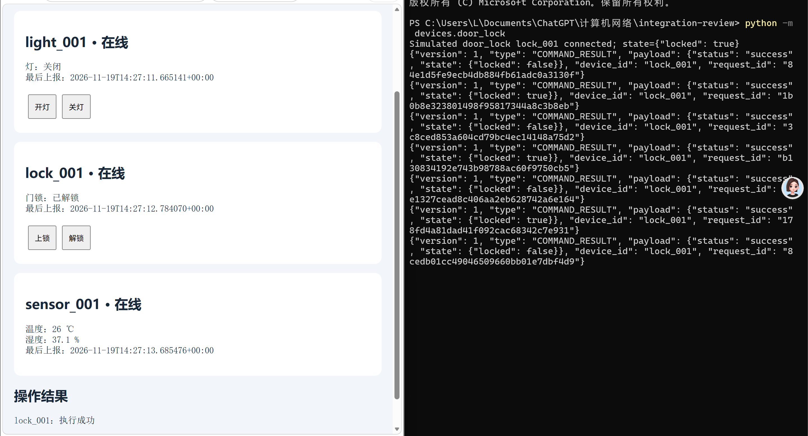

### Figure 3: Light on

The UI shows On and command success; the terminal reports power=true.

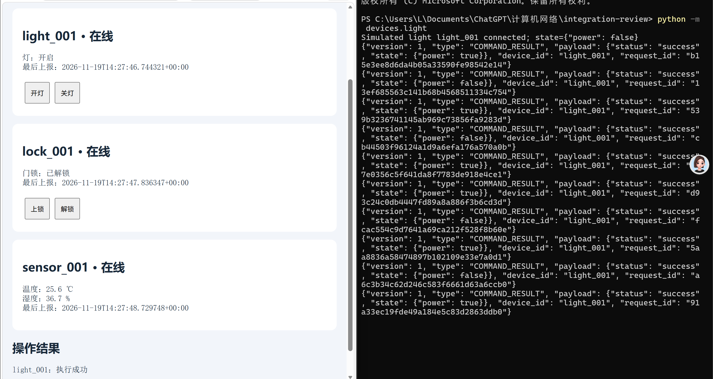

### Figure 4: Light off

The UI shows Off and command success; the terminal reports power=false. Sensor values have changed since Figure 3.

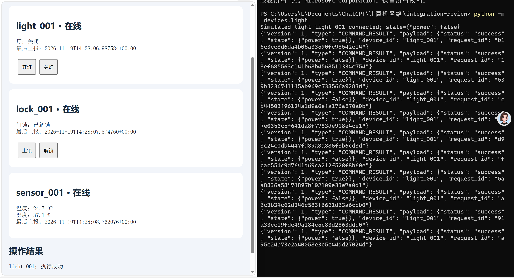

### Figure 5: Live connection lost

The warning identifies stale state and disabled controls. Retained Online labels are old snapshot values, not evidence of current connectivity.

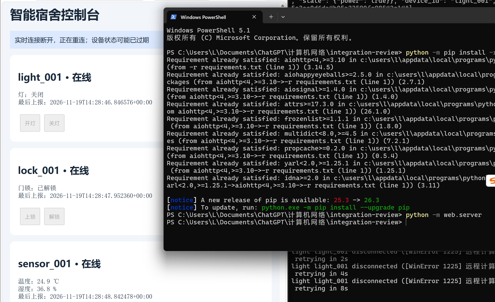

### Figure 6: Partial recovery

The connection is restored and sensor data is updated. This frame alone does not prove light/lock recovery or a new command; the previous success message may be retained.


### Figure 7: All device states restored

The live connection is established and light, lock and sensor are online with newer timestamps. Controls are available. A new post-recovery command is not shown.

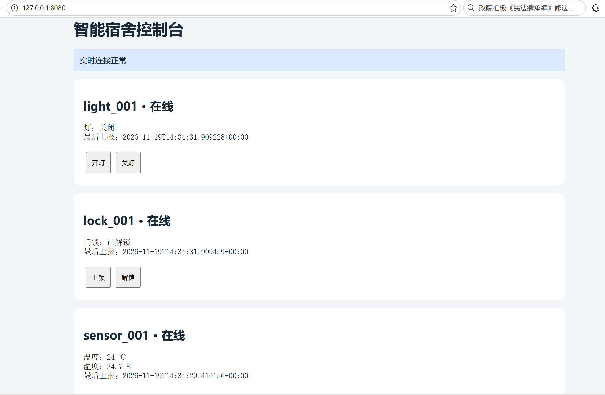

### Figure 8: Light commands after reconnection

The terminal shows reconnection followed by new successful power=true and power=false results. The UI shows the light online and off.

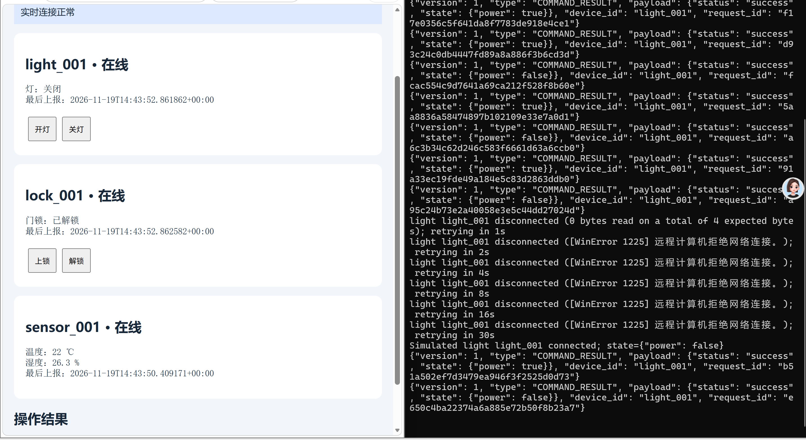

### Figure 9: Lock commands after reconnection

The terminal shows reconnection followed by successful locked=true and locked=false results. The UI shows Unlocked and command success.

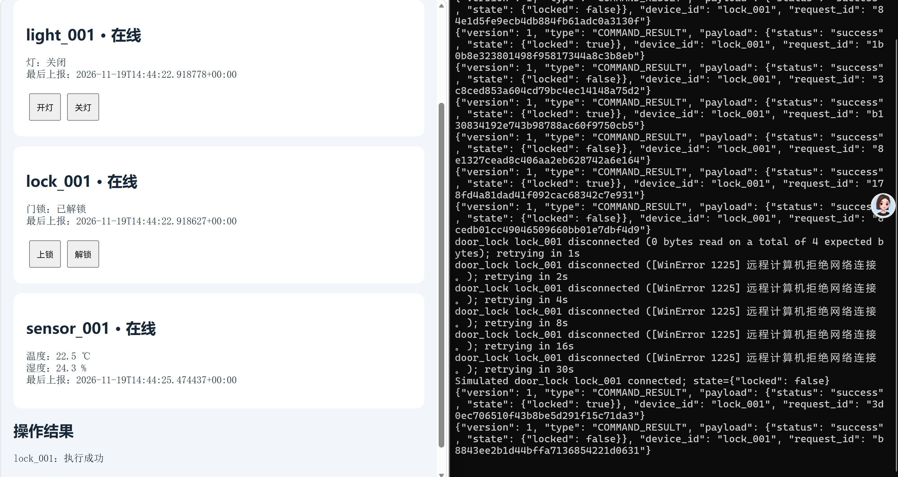

### Figure 10: Two-page state consistency

Two browser windows show matching device states and last-seen timestamps. The user supplied this as the multi-page test record; a static frame does not independently demonstrate update latency or absence of manual refresh.

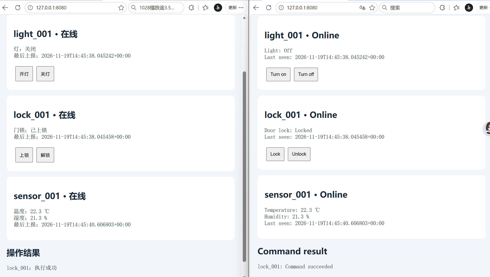

### Figure 11: Snapshot after page refresh

User-provided refresh-test screenshot shows the English console connected with all three devices online. This records the observed snapshot, not the refresh action itself.

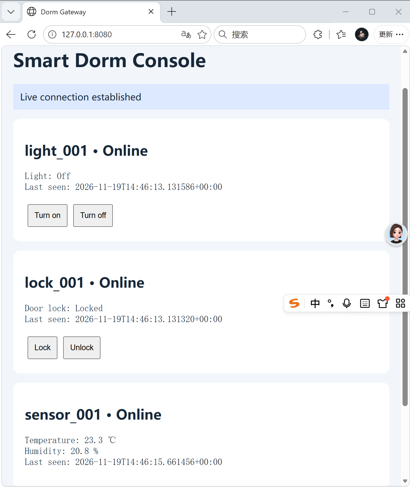

### Figure 12: Light offline

The light is Offline and its controls are disabled. The lock and sensor remain Online with later timestamps; the light terminal has returned to its prompt.

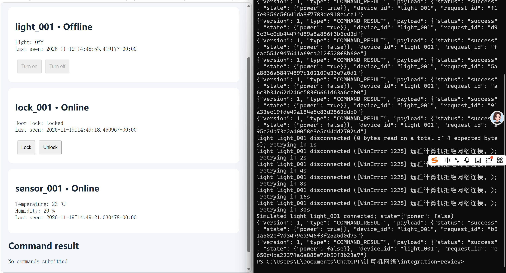

### Figure 13: Light restarted

A new python -m devices.light invocation registers the light. The UI shows Online with enabled controls and a fresh timestamp. No new command after this particular restart is captured.

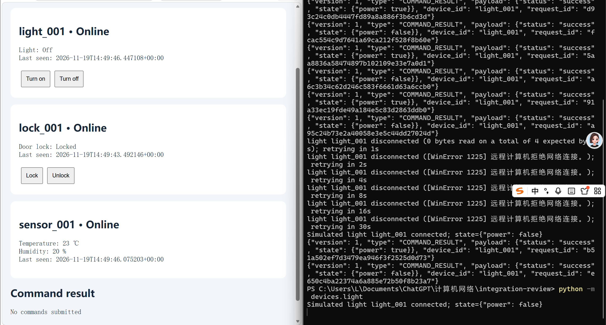

### Figure 14: Lock offline

The lock is Offline and its controls are disabled while light and sensor remain Online. The terminal has returned to its prompt.

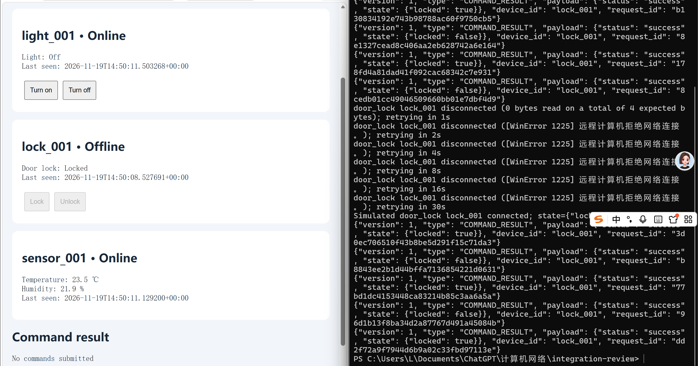

### Figure 15: Sensor expired

The sensor is Offline with its last sample retained. Light and lock remain Online, and the lock has a successful command result.

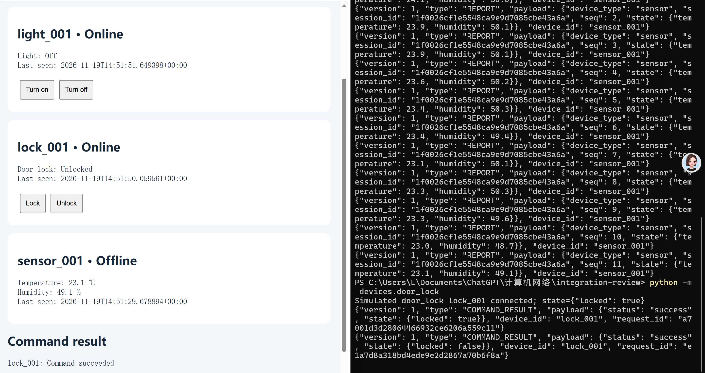

### Figure 16: Sensor remains offline

Sensor state and last-seen timestamp remain unchanged while other devices have later timestamps. Terminal report history alone does not establish current transmission; the process is at a prompt.

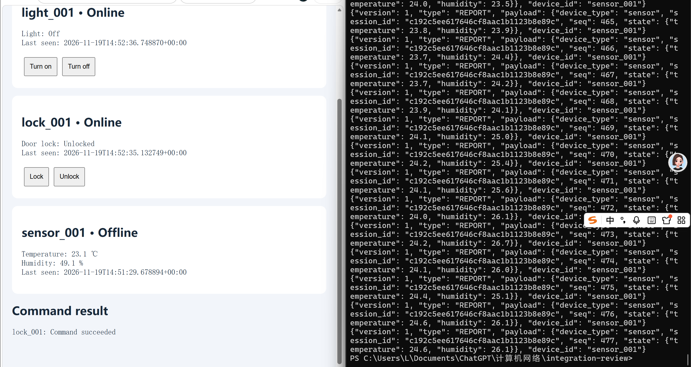

### Figure 17: Sensor restarted and reporting

A new sensor process uses a new session_id and increasing sequence numbers. The UI is Online, and its 23.6 C / 48.6 % sample matches the visible seq=3 report.

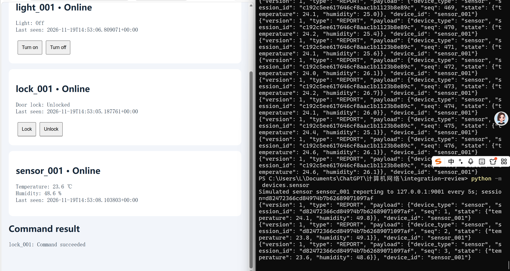

## Remaining acceptance checks

- Capture a new successful light command after the isolated light restart and complete an isolated lock restart/control cycle. Reconnection/control after the earlier gateway interruption is already evidenced in Figures 8-9.
- If required, record a short two-page video showing an automatic state transition without refreshing either page; Figure 10 records a matching snapshot.
- Open `/api/devices` and compare returned states with the UI.
- Capture executing, failed and unknown results using supported reproducible fault injection. Coordinate with device/reliability owners where necessary.

Log persistence/query remains a separate member's responsibility. No missing log data is fabricated. Only observed screenshot outcomes are recorded; no new automated test run was performed for this documentation-only update.
