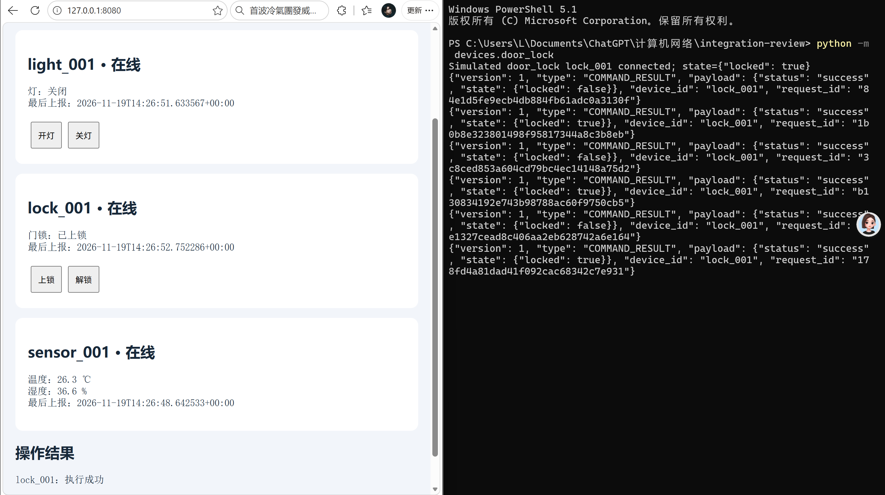
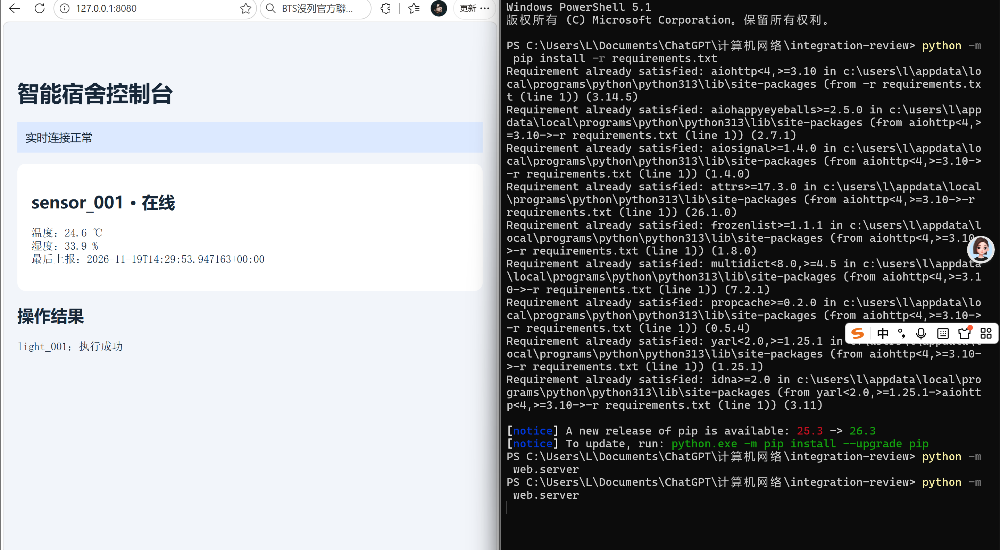

# Member C: Web Console Delivery and Acceptance

Updated: 19 November 2026. Branch: `yuan-web-console`.

## Scope

HTTP device queries and control, WebSocket state updates, connection-loss feedback, automatic reconnection, light and door-lock controls, temperature/humidity display, and command feedback are implemented. Device state is obtained from the gateway; clicking a button does not assume successful execution. This module reuses Gateway and does not implement device sockets, retries, or device deduplication.

## Running

From the repository root:

```sh
python -m pip install -r requirements.txt
python -m web.server
```

Open http://127.0.0.1:8080 . In separate terminals run `python -m devices.light`, `python -m devices.door_lock`, and `python -m devices.sensor`. The web entry point already starts the gateway. Use `--help` and [integration instructions](integration.md) for supported configuration.

## Interface contract

- `GET /`: web console.
- `GET /api/devices`: `{devices: [...]}` from `list_devices()`.
- `POST /api/devices/{device_id}/commands`: JSON containing `action` (`set_power` or `set_locked`) and boolean `value`; awaits `submit_command()` and returns its result. HTTP 400 rejects invalid input; 422 rejects unsupported commands. HTTP 200 still requires checking business status.
- `/ws`: initial snapshot and subsequent `{event, devices}` messages from EventBus. Each connection has a 32-message queue; oldest messages are dropped on overflow. Messages include full state snapshots; this is not an audit log.

The browser reconnects after two seconds and refreshes its snapshot. During disconnection, controls are disabled and displayed state is marked potentially stale. Seen-device history is in memory only. The default listener is loopback; this module does not provide authentication or production door-access security.

## Verification

On 16 November, all 46 automated tests passed, including real TCP door-lock and UDP/web integration. UDP socket/transport ResourceWarnings were observed and remain assigned to the device/integration owner. The success-message precedence fix was subsequently checked against success, unknown, failed, API-error and unrecognized-response cases. The English UI update does not constitute a new full regression run.

## User-provided browser acceptance evidence

Evidence date: 19 November 2026. Environment visible in screenshots: Windows PowerShell and a browser at 127.0.0.1:8080; browser version was not supplied. Screenshot timestamps use UTC (+00:00). Original Chinese-language screenshots are retained unchanged as historical evidence collected before the English UI update. Captions describe only visible evidence.

| Check | Evidence | Result |
|---|---|---|
| Device listing | Figures 1-4 | Light, lock and sensor shown online |
| Light on/off | Figures 3-4 | UI state and terminal success results agree |
| Lock/unlock | Figures 1-2 | UI state and terminal success results agree |
| Sensor updates | Figures 1-4 | Values and report timestamps change |
| Connection loss | Figure 5 | Warning displayed and controls disabled |
| Connection recovery | Figure 7 | Live connection and all three online devices restored |
| Control after recovery | Not shown | Pending |
| Independent device offline/restart | Not shown | Pending |
| Executing/failed/unknown feedback | Not captured | Pending |

### Figure 1: Door locked

The UI shows Locked and command success. The latest terminal result reports locked=true.



### Figure 2: Door unlocked

The UI shows Unlocked and command success. A new terminal result reports locked=false.


### Figure 3: Light on

The UI shows On and command success; the terminal reports power=true.


### Figure 4: Light off

The UI shows Off and command success; the terminal reports power=false. Sensor values have changed since Figure 3.


### Figure 5: Live connection lost

The warning identifies stale state and disabled controls. Retained Online labels are old snapshot values, not evidence of current connectivity.


### Figure 6: Partial recovery

The connection is restored and sensor data is updated. This frame alone does not prove light/lock recovery or a new command; the previous success message may be retained.



### Figure 7: All device states restored

The live connection is established and light, lock and sensor are online with newer timestamps. Controls are available. A new post-recovery command is not shown.


## Remaining acceptance checks

1. After recovery, operate the light and lock again and capture successful results.
2. Stop only the light; verify it becomes offline while other devices continue updating. Restart it and verify control works.
3. Stop the sensor, wait for gateway expiry, then restart it. Verify offline/online transitions and fresh timestamps.
4. Refresh the page while devices have known states; verify the snapshot agrees.
5. Open two tabs, control a device in one, and verify state updates in the other.
6. Open `/api/devices` and compare returned states with the UI.
7. Capture executing, failed and unknown results using reproducible supported fault injection, coordinating with device/reliability owners as necessary.

Log persistence/query remains a separate member's responsibility. No missing log data is fabricated. Pending checks must not be recorded as passed without evidence.
